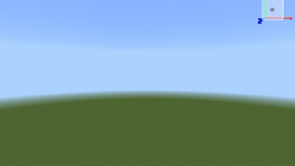

# 结构导入器 Structure Importer

> [!IMPORTANT]
> **本项目由 AI 生成**：代码、UI、文档均由 AI（WorkBuddy 智能体）在人类指导下编写与调试，经真机多轮实测迭代而成。仅供学习交流使用，请自行评估后再使用。

网易《我的世界》中国版 MOD：把本地 `.mcstructure` 结构文件一键导入世界，支持超大结构分区导入与自动地图画生成。



## 功能特性

- **一键导入**：本地 `.mcstructure` / `.nbt` 结构原样落地，方块、方块状态、朝向、实体、方块实体（箱子内容/告示牌文字等）完整保留
- **超大结构无忧**：自动按 16×16 分区，玩家跟随传送保证区块加载；写失败的方块自动重试补全；百万方块级结构可完整落地
- **急速模式**：跳过区块等待直接写入，速度优先，靠自动重试兜底
- **分块防卡顿**：巨型结构自动切块依次导入
- **地图画模式**：导入完成后自动搭建地图墙 → 自动巡图绘制 → 自动挂框，一面墙就是一幅完整像素画
- **跨行降速**：竖排分区换行的大距离传送自动降速等区块，参数可调
- **图文说明书**：游戏内自定义书本物品（右键打开），四大目录覆盖全部功能
- **全参数可调**：巡图分区数 / 每区停留 / 跨行降速时长均可用聊天命令实时调整并存档

## 安装

1. 用 [MC Studio](https://mc.163.com/dev/) 打开本项目（或把两个 pack 文件夹与 `world_*_packs.json` 拷入你的开发世界）
2. 确认行为包 `Script_NeteaseMod_TtCLQKGx` 与资源包正确挂载
3. 进入世界即可使用

> 本 MOD 使用本地文件系统扫描结构目录，仅适用于电脑端开发/本地游玩场景。

## 使用

```
/structureim dir <路径>        设置结构文件夹（如 D:\我的结构）
/structureim scan              重新扫描
/structureim list [页]         聊天栏列出结构
/structureim place <序号|名字> [旋转0-3]
/structureim pause / stop / info
/structureim ui                图形界面
/structureim znum <1-9>        地图画：每幅巡几个分区（默认 3）
/structureim zwait <1-30>      地图画：每区停留秒数（默认 3）
/structureim bigwait <1-30>    跨行远传后降速秒数（默认 4）
/structureim manual            聊天框版教程
/structureim selftest          环境自检
```

巡图机制：地图由携带者持续绘制——一区发图进主手，跟着传送走完各分区，收图后回墙统一挂框。

## 目录结构

```
behavior_pack_.../Script_NeteaseMod_TtCLQKGx/
  modMain.py     入口与系统注册
  si_srv.py      服务端主逻辑（导入状态机/地图画状态机）
  si_scan.py     本地结构目录扫描
  si_nbt.py      NBT 解析与引擎写入格式转换
  si_cfg.py      全部可调参数
  si_ui.py       图形界面（主界面 + 设置页）
  si_cli.py      客户端系统
behavior_pack_.../customBooks/si_manual/   游戏内说明书（自定义书本）
resource_pack_.../ui/                       MOD UI 布局
```

## 平台上架须知

中国版组件审核环境使用 **Python 模块白名单**（`os` / `sys` 等不在白名单），因此「扫描本地目录」功能无法通过组件市场机审。若要上架组件市场，需要将结构以内置数据模块形式打包（仓库历史中有该方案的实现思路）。本仓库保留完整本地版，供本地游玩与学习交流。

## License

MIT

---

*This project was primarily generated by AI (WorkBuddy agent) under human direction and tested in-game. Use at your own discretion.*
